<p align="center">
  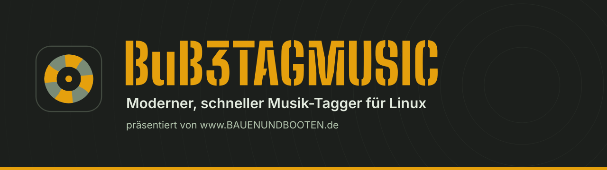
</p>

<p align="center">
  <a href="../../releases/latest"></a>
  <a href="LICENSE"></a>
  
  
  
  
  
</p>

<p align="center">
  <b>Tags, Cover und Dateinamen deiner Musiksammlung aufräumen – Ordner für Ordner, schnell und mit Vorschau.</b><br>
  Für riesige Sammlungen, für alte Rechner und für alle, die es genau nehmen.
</p>

<p align="center">
  <a href="#schnellstart">Schnellstart</a> ·
  <a href="#funktionen">Funktionen</a> ·
  <a href="#sicherheit">Sicherheit</a> ·
  <a href="#tastenkuerzel">Tastenkürzel</a> ·
  <a href="ANLEITUNG.md">Bau-Anleitung</a> ·
  <a href="CHANGELOG.md">Änderungen</a>
</p>

<p align="center">
  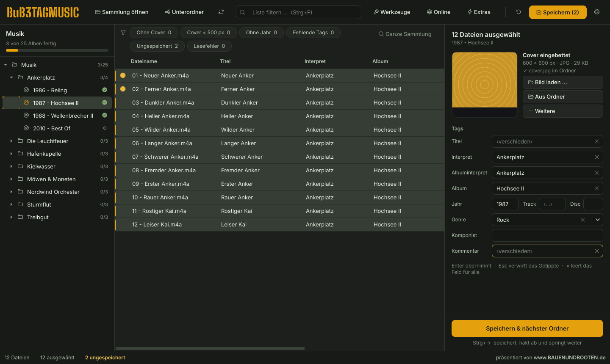
</p>

---

## ⚓ Auf einen Blick

| Stärke | Was das heißt |
|---|---|
| 📂 **Ordner für Ordner** | Links deine Sammlung als Baum (Künstler → Alben) mit Fortschritt. Album anklicken, bearbeiten, **Strg+→** speichert, hakt ab und springt zum nächsten offenen Album. |
| ✏️ **Viele Dateien auf einmal** | Alle Dateien eines Albums – oder mit „Unterordner“ einen ganzen Künstler – gleichzeitig bearbeiten. Unterschiedliche Werte zeigen `‹verschieden›` und bleiben, wie sie sind – oder du wählst per Pfeil einen davon für alle. |
| 🖼️ **Cover & Künstlerbild** | Einbetten, `cover.jpg` im Album-Ordner, `folder.jpg` im Künstler-Ordner – per Drag & Drop, aus dem Ordner oder online gesucht. |
| 🌐 **Online** | MusicBrainz, Discogs, Deezer, iTunes & Last.fm (eine Suche pro Album), Cover bis 3000 px, Künstlerfotos, Erkennen per Fingerabdruck. |
| 🎤 **Songtext, Label, Original-Jahr** | Songtexte eintippen oder aus `.lrc`/`.txt` übernehmen – auch für ein ganzes Album auf einmal. |
| 🛠️ **Werkzeuge** | Tags ↔ Dateinamen, nummerieren, Schreibweise, Suchen & Ersetzen, aufräumen, Ordner umbenennen – und alles zusammen als **Aktion**. |
| ⚡ **Schnell, auch auf alter Hardware** | 12.000 Dateien in unter 2 Sekunden eingelesen, danach aus dem Zwischenspeicher in Sekundenbruchteilen. 50.000 Einträge in der Liste sind kein Problem. |
| 📦 **Keine Installation** | `make` baut eine einzige ausführbare Datei (AppImage) – mit allem drin, sogar den Hilfsprogrammen. |
| 🎨 **Modern & klar** | Fünf Farb-Themes, deutsche Oberfläche, alles auf den ersten Blick verständlich. |

---

<a name="schnellstart"></a>

## 🚀 Schnellstart

**Fertige Datei:** unter [Releases](../../releases/latest) `BuB3TAGMUSIC-…-x86_64.AppImage` herunterladen,
ausführbar machen (`chmod +x` oder Rechtsklick → Eigenschaften), Doppelklick – fertig.

**Oder selbst bauen** – mit `make` oder einfach mit `sh build.sh`:

```bash
sudo apt install make wget git      # einmalig (Fedora: dnf · Arch: pacman · openSUSE: zypper)
make                                # oder: sh build.sh  →  dist/BuB3TAGMUSIC-<version>-x86_64.AppImage
./dist/BuB3TAGMUSIC-*-x86_64.AppImage ~/Musik
```

Optional: `make install` (oder `sh build.sh --install`) trägt BuB3TAGMUSIC ins Startmenü ein –
oder im Programm ⚙ → *Ins Startmenü eintragen*.

**Läuft auf jedem 64-Bit-Linux ab etwa 2018:** Ubuntu 20.04+, Linux Mint 20+, Debian 10+, Fedora 29+,
openSUSE Leap 15.3+, Arch/Manjaro – unter X11 und Wayland. Python, Qt und alles Weitere bringt die Datei selbst mit.

👉 Ausführlich, mit Hilfe bei Problemen: **[ANLEITUNG.md](ANLEITUNG.md)**

> [!TIP]
> Die ersten Schritte am besten an einer **Kopie** eines Teils der Sammlung ausprobieren.

---

<a name="funktionen"></a>

## ✨ Funktionen

### So arbeitest du damit

1. **Sammlung öffnen** (Strg+O) – oder den Musik-Ordner einfach ins Fenster ziehen.
2. **Album anklicken.** Alle Dateien werden geladen und sind gleich ausgewählt.
3. **Rechts bearbeiten.** Was du einträgst, gilt für alle ausgewählten Dateien. Geändertes leuchtet gelb, bis es gespeichert ist.
4. **Strg+→** – speichern, Album als fertig abhaken ✓, weiter zum nächsten offenen Album.

So arbeitest du dich durch zehntausende Dateien, ohne den Überblick zu verlieren: Der Baum zeigt, welche Alben fertig sind
und wie viel von der Sammlung schon geschafft ist.

### 🎤 Songtext, Label & Original-Jahr

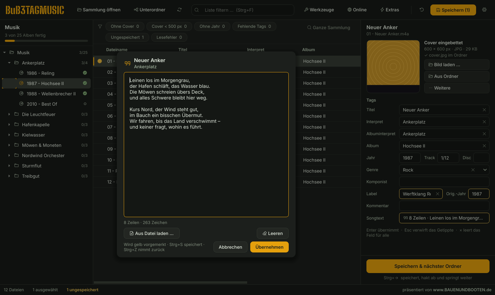

Unter den üblichen Feldern stehen **Label** (Plattenfirma), **Original-Jahr** (Erstveröffentlichung – bei Remasters
älter als „Jahr“) und der **Songtext**. Der Songtext ist im Bearbeitungsfeld nur eine Zeile („8 Zeilen · Leinen los …“);
ein Klick öffnet das Songtext-Fenster zum Lesen, Eintippen oder Einfügen. **Aus Datei laden** nimmt `.lrc` und `.txt` –
Zeitmarken wie `[01:23.45]` werden dabei entfernt. Liegen neben den Liedern gleichnamige Songtext-Dateien
(`01 - Titel.lrc`), übernimmt **Aus Begleitdateien** alle auf einmal, jede Datei ihren eigenen Text.
Schreibweisen anderer Programme (Picard, Mp3tag) werden erkannt.

### 🧑‍🎤 Künstler-Ordner & folder.jpg

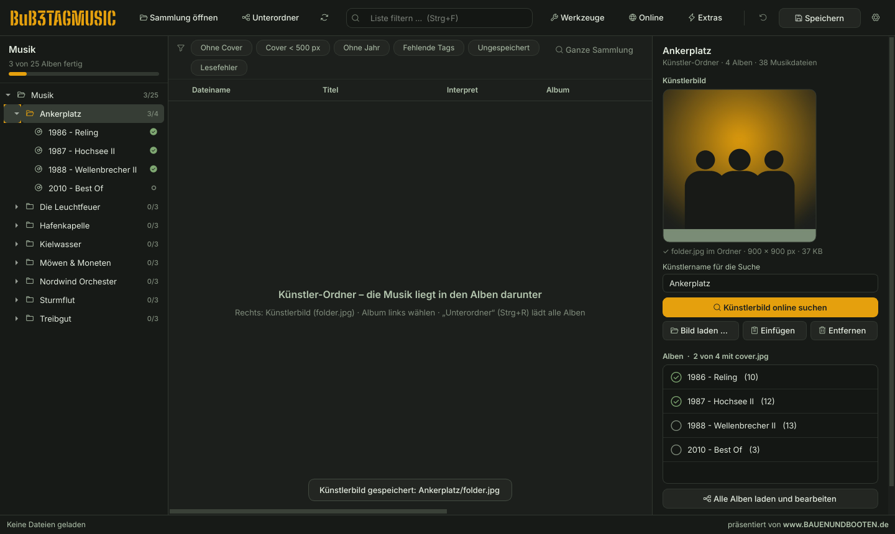

Klickst du links einen **Künstler-Ordner** an – also einen Ordner ohne eigene Musik, in dem die Alben liegen –, zeigt
die rechte Seite das **Künstlerbild** (`folder.jpg` in genau diesem Ordner): reinziehen, laden, einfügen oder
**online suchen**. Der Ordnername ist schon als Künstlername eingetragen – passt er nicht, einfach ändern.
Darunter siehst du alle Alben mit Häkchen, ob sie schon ihr `cover.jpg` haben, und kannst mit einem Klick alle Alben
zum Bearbeiten laden. Ein ersetztes Künstlerbild landet im Papierkorb. Auch per Rechtsklick auf jeden Ordner im Baum:
*Künstlerbild für diesen Ordner suchen*.

### 🛠️ Werkzeuge – immer mit Live-Vorschau

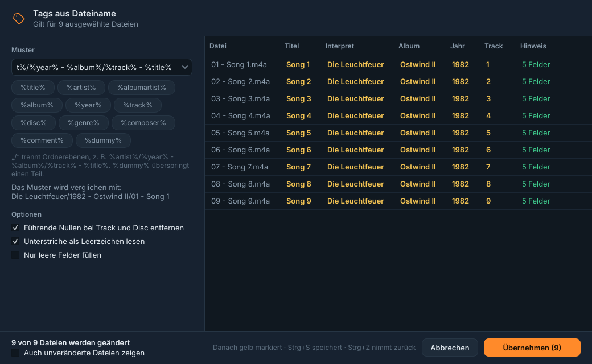

| Werkzeug | Was es macht |
|---|---|
| **Tags aus Dateiname** (Alt+1) | Füllt Felder aus Datei- **und Ordnernamen**: `%artist%/%year% - %album%/%track% - %title%`. Tippfehler im Muster werden erkannt. |
| **Dateinamen aus Tags** (Alt+2) | `%track% - %title%` → `03 - Am Kai.flac`. Prüft vorher fehlende Tags und doppelte Namen, überschreibt nie etwas; Begleitdateien (`.lrc`, `.txt` …) wandern mit. |
| **Tracks nummerieren** (Alt+3) | Pro Ordner, mit Gesamtzahl (3/12), führender Null, Disc-Nummer aus „CD1“, „Disc 2“ … |
| **Groß-/Kleinschreibung** (Alt+4) | `DER TITEL` → `Der Titel`; kleine Wörter und feste Schreibweisen (AC/DC …) einstellbar, „iPhone“ bleibt „iPhone“. |
| **Suchen & Ersetzen** (Alt+5) | In gewählten Feldern, auf Wunsch mit regulären Ausdrücken (`$1`). |
| **Ordner umbenennen** (Alt+6) | Album-Ordner nach ihren Tags, z. B. `%year% - %album%` – alles im Ordner bleibt beisammen. |
| **Aufräumen** | Doppelte Leerzeichen, Unterstriche, leere Klammern, unsichtbare Zeichen, „ft.“ → „feat.“ … |

Übernehmen markiert gelb, **Strg+S** speichert, **Strg+Z** nimmt das ganze Werkzeug in einem Schritt zurück.

### ⚡ Aktionen – mehrere Schritte auf einmal

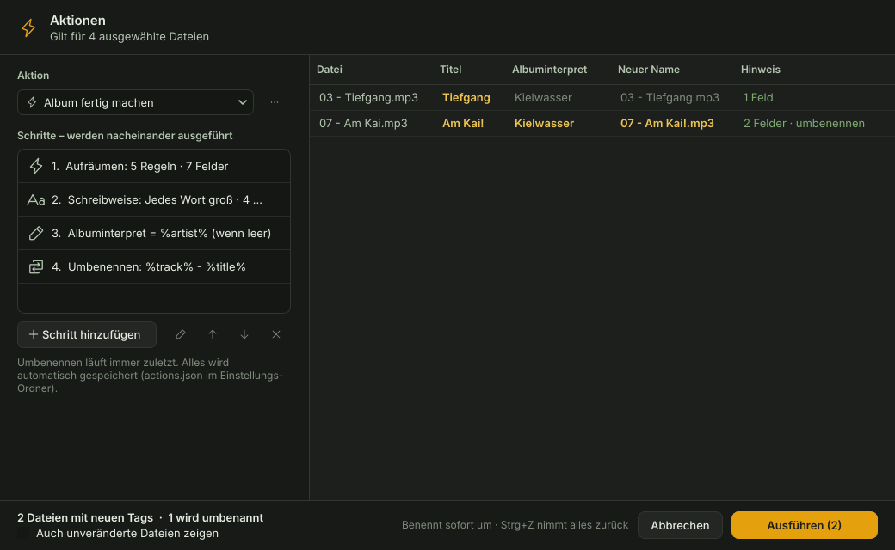

Lieblings-Abläufe als **Aktion** speichern (Alt+7): z. B. *aufräumen → Schreibweise → Albuminterpret = `%artist%` →
umbenennen*. Erst Vorschau, dann ausführen – **Strg+Z nimmt alles in einem Schritt zurück, auch das Umbenennen.**
Beispiel-Aktionen sind schon dabei.

### 🌐 Online

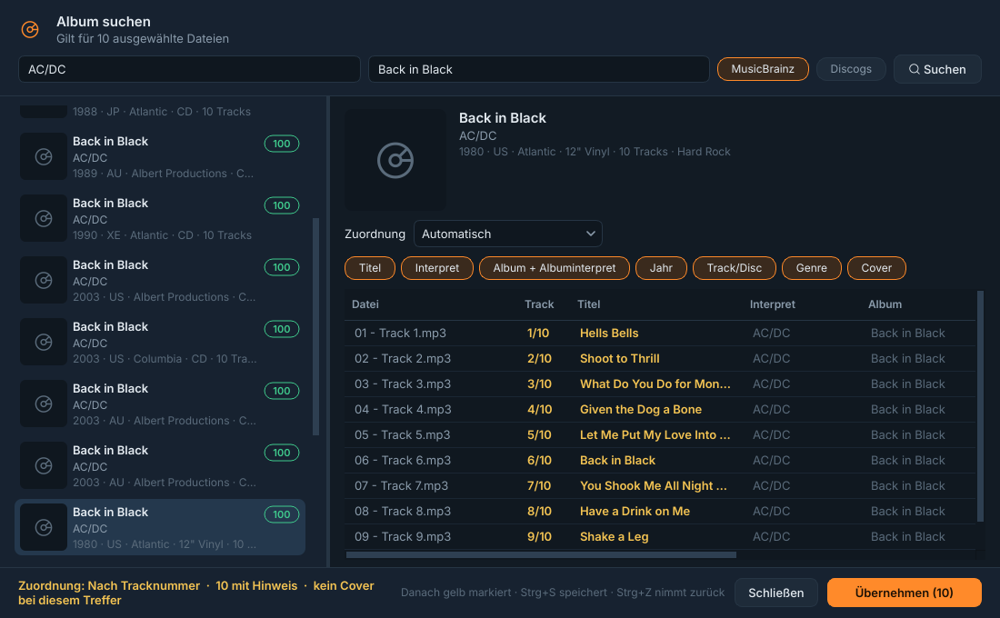

| Funktion | Was sie macht |
|---|---|
| **Album suchen** (Strg+L) | **MusicBrainz**, **Discogs**, **Deezer**, **iTunes** oder **Last.fm** – genau *eine* Suche pro Album. Die Trackliste wird deinen Dateien zugeordnet (nach Tracknummer, Reihenfolge oder Länge), du wählst die Felder – auch Label und Original-Jahr, auf Wunsch samt Cover. „Ohne Remaster-Zusätze“ macht aus „Titel (Remastered 2011)“ einfach „Titel“. **Alle Quellen** fragt alle Dienste gleichzeitig; **Übernehmen & weiter** (Strg+→) speichert und sucht gleich im nächsten Ordner – ohne das Fenster zu schließen. |
| **Cover suchen** (Strg+K) | Cover Art Archive, iTunes (bis 3000 px), TheAudioDB und Bandcamp als Bildergitter. Einbetten und/oder `cover.jpg`. |
| **Künstlerbild suchen** (Strg+J) | Fotos von TheAudioDB, Bandcamp, Discogs (mit Token) und Wikipedia → `folder.jpg` im Künstler-Ordner. |
| **Unbekannte Dateien erkennen** (Strg+Shift+L) | Dateien **ganz ohne Tags** am Klang erkennen (Fingerabdruck + AcoustID) – mit Treffer-Prozent und Vorschau. |

Ohne Anmeldung nutzbar – nur Discogs, Last.fm und AcoustID brauchen einen kostenlosen Schlüssel (*Einstellungen → Online*).

### 🔎 Schnellfilter – auch über die ganze Sammlung

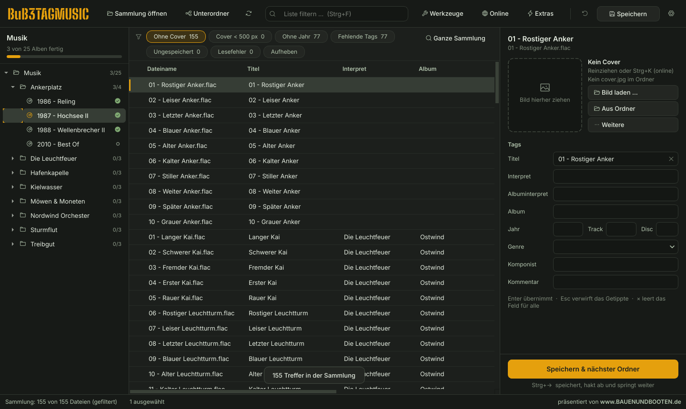

**Ohne Cover · Cover < 500 px · Ohne Jahr · Fehlende Tags · Ungespeichert · Lesefehler** – kombinierbar, mit Anzahl.
Ein Klick auf **Ganze Sammlung** holt alle passenden Dateien aus der ganzen Sammlung in die Liste –
z. B. „alle ohne Cover“ und gleich danach *Cover suchen*.

### 🧹 Duplikate finden

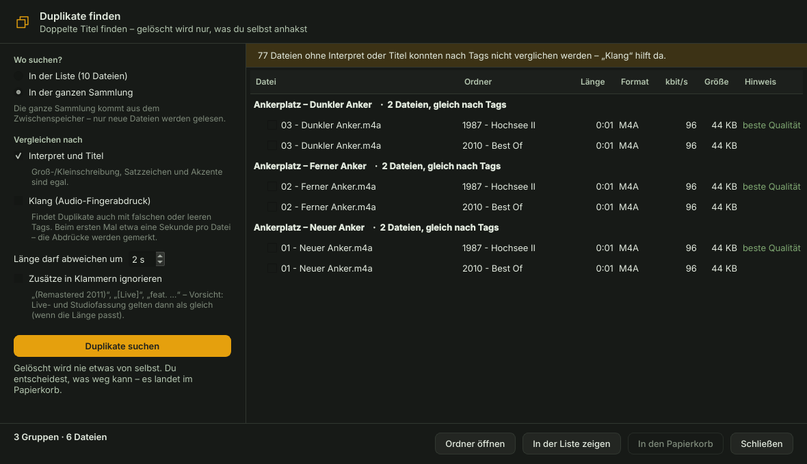

Nach **Interpret + Titel** (Akzente und Satzzeichen egal, Länge ± einstellbar) oder nach **Klang** – dann auch, wenn die
Tags falsch oder leer sind. Die Datei mit der besten Qualität ist markiert. **Gelöscht wird nie etwas von selbst:**
nur was du anhakst, und das landet im Papierkorb. Eine Datei jeder Gruppe bleibt immer.

### 🔊 ReplayGain

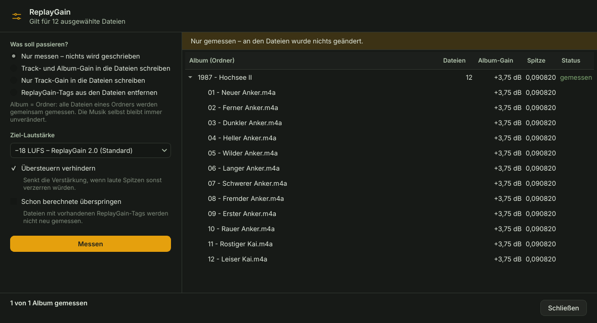

Misst die Lautheit pro Track und Album (Album = Ordner). **Standard ist „Nur messen“ – da wird nichts geschrieben.**
Wer die Werte in die Dateien schreiben oder entfernen will, muss das bewusst auswählen und bekommt eine rote Warnung
und eine Rückfrage. Spalten *RG Track* / *RG Album* gibt es per Rechtsklick auf den Spaltenkopf.

### 📤 Liste exportieren

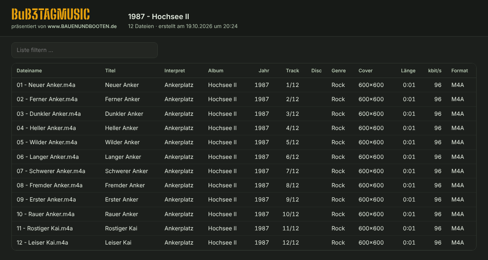

Strg+Shift+E: die sichtbaren Spalten in ihrer Reihenfolge als **CSV** (LibreOffice, Excel) oder als eigenständige
**HTML-Seite** – sortierbar, durchsuchbar, hell/dunkel, druckbar. Perfekt, um die Sammlung weiterzugeben.

### 🎨 Fünf Farb-Themes

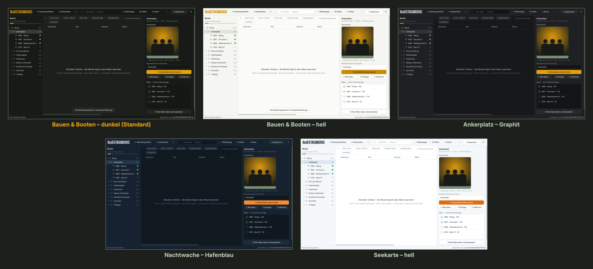

Standard ist **„Bauen & Booten“** in den Farben von [www.BAUENUNDBOOTEN.de](https://www.BAUENUNDBOOTEN.de).
Wechseln unter ⚙ → *Farben*; *Hell / Dunkel umschalten* springt zum passenden Gegenstück.

---

<a name="sicherheit"></a>

## 🛟 Deine Musik ist sicher

- **Nur Tags, nie die Musik:** Audiodaten werden nie verändert. Es werden nur Felder geschrieben, die du geändert hast –
  alle anderen Tags, auch unbekannte, bleiben unangetastet.
- **Erst Vorschau, dann übernehmen:** Jedes Werkzeug, jede Aktion und jede Online-Übernahme zeigt vorher genau,
  was sich ändert.
- **Rückgängig – auch nach dem Speichern:** Strg+Z nimmt Bearbeitungen zurück, und auch die letzten 20 Speichervorgänge
  und Umbenennungen.
- **Umbenennen überschreibt nie:** doppelte Namen und vorhandene Dateien werden vorher erkannt.
- **Eine kaputte Datei stoppt nie den Rest** – Fehler werden gesammelt angezeigt.
- **Gelöscht wird nichts automatisch.** Duplikate wandern nur auf deinen Wunsch in den Papierkorb.
- **Offline und werbefrei.** Ins Internet geht es nur, wenn du eine Online-Funktion nutzt – MusicBrainz höchstens
  einmal pro Sekunde, wie es sich gehört.

---

## 🎵 Formate

**MP3** (ID3v2.3 / v2.4, ID3v1) · **FLAC** · **M4A** (AAC/ALAC) · **OGG Vorbis** · **Opus** · **WMA** · **WAV** ·
**AIFF** · **APE** · **WavPack** · **DSF**

MP3 wird standardmäßig als ID3v2.3 geschrieben (läuft auch auf Autoradios). Eingebettete Cover werden auf 600 px
verkleinert (einstellbar), `cover.jpg` im Ordner bleibt in voller Größe.

---

<a name="tastenkuerzel"></a>

## ⌨️ Tastenkürzel

<details>
<summary><b>Alle Tastenkürzel anzeigen</b> (im Programm: F1)</summary>

| Kürzel | Funktion |
|---|---|
| Strg+→ / Strg+← | Speichern & nächster offener Ordner / vorheriger Ordner |
| Strg+S | Speichern |
| Strg+Z | Rückgängig (auch schon Gespeichertes) |
| Strg+D | Ordner als fertig / offen markieren |
| Strg+R | Unterordner mitladen an/aus |
| Strg+O | Sammlung öffnen |
| Strg+A | Alle Dateien auswählen |
| Strg+E | Zum Feld „Titel“ |
| Alt+↓ | Im Feld mit ‹verschieden›: vorhandene Werte zur Auswahl |
| Strg+F | Liste filtern |
| F2 | Zelle in der Liste bearbeiten |
| Strg+Shift+V | Bild aus der Zwischenablage als Cover |
| Alt+1 … Alt+6 | Werkzeuge |
| Alt+7 | Aktionen |
| Strg+L / Strg+K / Strg+J | Album / Cover / Künstlerbild online suchen |
| Strg+Shift+L | Unbekannte Dateien erkennen |
| Strg+Shift+E | Liste exportieren |
| F5 | Neu einlesen |
| Strg+, | Einstellungen |
| F1 | Alle Tastenkürzel |

</details>

---

## 📊 Leistung

Gemessen auf einem Testrechner mit 2 Kernen:

| Vorgang | Zeit |
|---|---|
| Ordnerbaum mit 1.000 Alben / 12.000 Dateien | 0,04 s |
| 12.000 Dateien erstmals einlesen | 1,7 s |
| dieselben 12.000 Dateien aus dem Zwischenspeicher | 0,15 s |
| Liste mit 50.000 Einträgen füllen / sortieren / filtern | 0,2 s / 0,1 s / 0,15 s |
| Genre für 50.000 Dateien setzen / rückgängig | 0,3 s / 0,25 s |

Echte MP3s mit großen Covern auf einer alten Festplatte brauchen beim ersten Einlesen etwas länger – danach greift der Zwischenspeicher.

---

## ❓ Häufige Fragen

<details>
<summary><b>Muss ich irgendetwas installieren?</b></summary>

Nein. `make` baut eine einzige Datei, die alles mitbringt – Python, Qt, die Schriften und sogar die Hilfsprogramme
`fpcalc` (Fingerabdruck) und `rsgain` (ReplayGain). Zum Bauen reichen `make` und `wget` oder `curl`.
</details>

<details>
<summary><b>Wo speichert BuB3TAGMUSIC seine Einstellungen?</b></summary>

Einstellungen und Aktionen: `~/.config/bub3tagmusic/` · Zwischenspeicher: `~/.cache/bub3tagmusic/`
(⚙ → *Zwischenspeicher leeren* liest alles neu ein).
</details>

<details>
<summary><b>Was ist mit cover.jpg und folder.jpg?</b></summary>

`cover.jpg` im **Album**-Ordner ist das Albumcover, `folder.jpg` im **Künstler**-Ordner das Künstlerbild.
Die Namen sind unter *Einstellungen → Cover* änderbar. Einzelne Alben und Tracks lassen sich trotzdem einzeln bearbeiten.
</details>

<details>
<summary><b>Brauche ich Zugangsdaten für die Online-Funktionen?</b></summary>

Für MusicBrainz, Deezer, iTunes, Cover-Suche und Künstlerbilder nicht. Discogs braucht einen kostenlosen Token
(discogs.com → Settings → Developers), Last.fm einen kostenlosen API-Key (last.fm/api/account/create),
„Unbekannte Dateien erkennen“ einen kostenlosen AcoustID-Key (acoustid.org/new-application).
Alles unter *Einstellungen → Online* eintragen.
</details>

<details>
<summary><b>MusicBrainz, Discogs oder Deezer – welche Quelle nehme ich?</b></summary>

**MusicBrainz** zuerst: sehr genau, kennt das **Original-Jahr** und Genres. **iTunes** als zweite Wahl: genaue
Tracklisten, meist das richtige Jahr, große Cover. **Deezer** für neue und deutsche Musik, mit Label – das Jahr ist dort
aber oft das der Neuauflage (dann „Jahr“ abwählen), Cover gibt es von Deezer nicht. **Discogs** für Vinyl, Raritäten
und Sampler. **Last.fm** vor allem für Genres. Im Fenster wechselst du die Quelle mit einem Klick – die Suche bleibt stehen.
</details>

<details>
<summary><b>Etwas klappt nicht – was tun?</b></summary>

Ein [Issue anlegen](../../issues/new/choose) – die Vorlage „Fehler melden“ fragt alles Nötige ab.
Hilfreich ist die Ausgabe von `./BuB3TAGMUSIC-*.AppImage --selftest ~/Musik`.
</details>

---

## 🧑‍💻 Für Entwickler

<details>
<summary><b>Aus dem Quellcode starten, Aufbau, Tests</b></summary>

```bash
./install.sh        # einmalig: eigene Python-Umgebung (.venv) + Startmenü-Eintrag
./start.sh ~/Musik  # bzw. make run
tests/run_all.sh    # alle Tests (braucht ffmpeg; fpcalc + rsgain für die Extras)
```

```
bub3tagmusic/
├── app.py            Programmstart (--version, --selftest)
├── features.py       alle Funktionen als Daten → baut die Menüs
├── core/             ohne Qt: Tags (mutagen), Cache (SQLite), Muster, Werkzeuge, Umbenennen,
│                     Filter, Export, Aktionen, Duplikate, Fingerabdruck, ReplayGain
├── online/           ohne Qt: http (Limiter, Zertifikate), MusicBrainz, Discogs, Deezer, iTunes, Last.fm, Cover, Künstlerbilder, AcoustID
└── ui/               Oberfläche: Hauptfenster, Session (Rückgängig), Hintergrund-Arbeiter, Dialoge, Themes
packaging/            AppImage-Bau (eigenes Python 3.12, Qt 6.9, fpcalc, rsgain, verschlankt)
tests/                Kern-, Oberflächen-, Online- (aufgezeichnet) und Leistungstests
docs/                 Bilder für diese Seite (neu erzeugen: python3 docs/make_images.py)
```

Bei jedem Hochladen laufen alle Tests auf GitHub (Python 3.10 und 3.13) und das AppImage wird gebaut und auf einem
echten X-Bildschirm gestartet. Die Online-Tests spielen echte, aufgezeichnete Antworten ab.
Fahrplan und Entscheidungen: [BuB3TAGMUSIC.md](BuB3TAGMUSIC.md) · Arbeitsnotizen: [CLAUDE.md](CLAUDE.md)
</details>

---

## 📜 Lizenz

BuB3TAGMUSIC ist freie Software unter der **[GNU GPL 3.0](LICENSE)** (oder später): nutzen, ändern und weitergeben
erlaubt – Weitergaben und Änderungen bleiben ebenfalls frei und mit Quelltext.
Mitgelieferte Teile behalten ihre eigenen Lizenzen (Qt: LGPL, Schriften: SIL OFL, fpcalc: LGPL, rsgain: BSD).

## 🙏 Dank

BuB3TAGMUSIC steht auf den Schultern von
[Qt / PySide6](https://www.qt.io/qt-for-python) ·
[mutagen](https://github.com/quodlibet/mutagen) ·
[Pillow](https://python-pillow.org) ·
[QtAwesome](https://github.com/spyder-ide/qtawesome) mit [Phosphor Icons](https://phosphoricons.com) ·
[Chromaprint / AcoustID](https://acoustid.org) ·
[rsgain](https://github.com/complexlogic/rsgain) ·
Schriften [Inter](https://rsms.me/inter/) und [Big Shoulders](https://github.com/xotypeco/big_shoulders) (SIL OFL)
– und den Daten von [MusicBrainz](https://musicbrainz.org), [Cover Art Archive](https://coverartarchive.org),
[Discogs](https://www.discogs.com), iTunes, Deezer, [Last.fm](https://www.last.fm), [TheAudioDB](https://www.theaudiodb.com),
[Bandcamp](https://bandcamp.com) und [Wikimedia Commons](https://commons.wikimedia.org).

<p align="center">
  <br>
  <b>BuB3TAGMUSIC</b> – präsentiert von <a href="https://www.BAUENUNDBOOTEN.de"><b>www.BAUENUNDBOOTEN.de</b></a>
</p>
